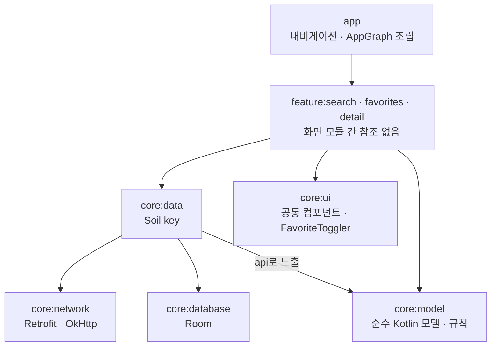
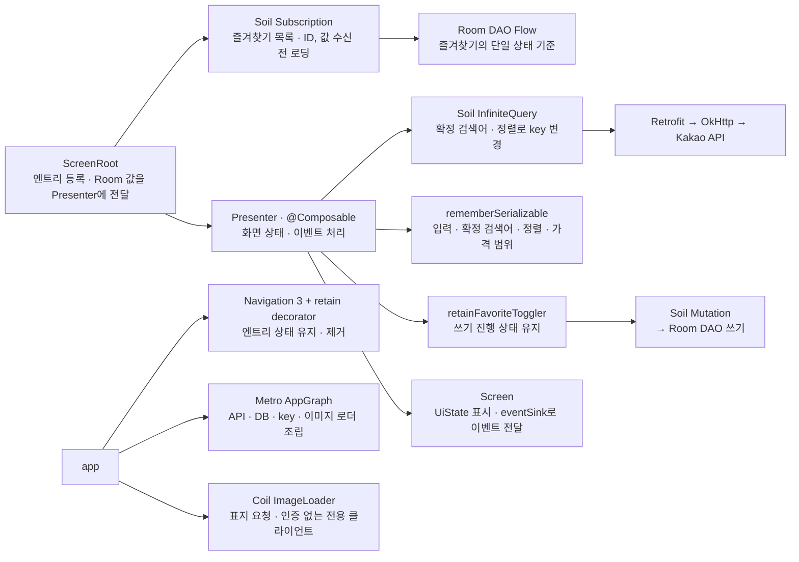

# 아키텍처

구현한 구조와 그 이유, 비용, 알려진 한계를 설명합니다. 필수 요구, 사용자 선택, 권장안, 미정을 구분해 적습니다. 요구사항과 검증 기록은 [REQUIREMENTS](REQUIREMENTS.md), 코드로 옮길 세부 계약은 [SPEC](SPEC.md), 실기기 시나리오는 [QA](QA.md), AI 활용과 판단 과정은 [AI_USAGE](AI_USAGE.md)에 있습니다.

## 1. 구성과 선택 상태

| 영역 | 기술 | 상태와 역할 |
| --- | --- | --- |
| 화면 | Jetpack Compose | 필수. 입력·표시·사용자 이벤트 전달 |
| 화면 모델 | Root + 얇은 @Composable Presenter | 현재 구현. Root의 데이터 관찰, Presenter의 화면 상태·이벤트·쓰기 명령 |
| 수명·이동 | retain + Navigation 3 | 사용자 선택. 엔트리별 유지·제거 및 백스택 |
| 비동기 상태 관리 | Soil typed-key | 원격 검색 InfiniteQuery, 로컬 Room 관찰 Subscription / 쓰기 Mutation |
| 페이지네이션 | Soil InfiniteQuery | 사용자 선택. 요청 key와 페이지 메타데이터 연결 |
| 원격 통신 | Retrofit + OkHttp + kotlinx.serialization | 사용자 선택. 요청·응답·직렬화 |
| 로컬 저장 | Room + Flow | 사용자 선택. 즐겨찾기의 단일 상태 기준 |
| 의존성 연결 | Metro | 사용자 선택. 필요한 객체와 최소 그래프 조립 |
| 표지 이미지 | Coil | 사용자 선택. Coil 3.6.3의 coil-compose + coil-network-okhttp |
| 로그 | Timber | 사용자 선택. debug 빌드에서만 출력 |

Android 전용이며 KMP 구성과 Circuit은 도입하지 않습니다(사용자 선택). 각 선택이 맡는 책임은 테스트로 확인합니다(7절).

## 2. 의존성과 데이터 흐름

모듈의 주요 의존 방향입니다. 화살표는 참조하는 모듈에서 참조 대상 모듈로 향합니다. 화면 모듈은 서로 참조하지 않으며, 네트워크·DB 접근은 `core:data` 뒤로 숨깁니다.



[Mermaid 소스](diagrams/module-dependencies.mmd)

`app`은 Metro 조립을 위해 `core:model`·`network`·`database`·`data`·`ui`도 직접 참조합니다. `core:testing`은 FakeFavoriteMutation와 Presenter 테스트 도구를 제공하는 테스트 전용 모듈입니다.

화면 하나의 연결 구조입니다. 화살표는 구성 요소의 연결·호출 관계이며, Room Flow 값은 Subscription을 거쳐 Root와 Presenter로 전달됩니다.



[Mermaid 소스](diagrams/screen-data-flow.mmd)

DroidKaigi 2026의 패턴을 얇게 적용합니다. Root가 Room subscription을 연결하고, Presenter는 UI 모델을 만들고 이벤트를 데이터 명령으로 연결합니다. 검색 InfiniteQuery는 확정 검색어에 따라 key가 바뀌므로 Presenter가 연결합니다. 화면은 DTO나 Room Entity를 직접 다루지 않습니다. typed-key가 이미 맡은 호출을 전달만 하는 Repository는 두지 않습니다. 이는 이 프로젝트의 책임 분리이며 Soil이 Repository를 금지한다는 뜻은 아닙니다. ID 정규화·가격 정책 같은 독립 규칙은 일반 Kotlin 함수로 둡니다.

Metro는 의존성을 연결할 뿐 화면 상태나 데이터의 기준을 대신하지 않습니다. 그래프는 앱 그래프 하나(`AppGraph`, `AppScope`)와 화면별 `GraphExtension` 세 개(`SearchScreenGraph`, `FavoritesScreenGraph`, `BookDetailScreenGraph`)입니다. `AppGraph`가 화면 그래프의 `Factory`를 구현하고, Retrofit·OkHttp·Room·`SwrCachePlus`·Coil `ImageLoader`를 싱글턴으로 둡니다.

### Metro factory와 retain 연결

DroidKaigi 2026의 `TimetableScreenGraph`·`TimetableNavEntryProvider`를 참고합니다. `@GraphExtension.Factory`의 구현은 Metro 컴파일러가 생성하고, 엔트리는 factory로 만든 그래프를 retain으로 유지합니다.

```kotlin
entry<BookDetailNavKey>(clazzContentKey = { it.book.id }) { key ->
    val graph = retain { graphFactory.createBookDetailScreenGraph() }
    BookDetailScreenRoot(context = graph.bookDetailScreenContext, snapshot = key.book, onBack = onBack)
}
```

화면 그래프는 그 화면의 Soil key와 공통 Mutation ID를 사용하는 key(`favoriteMutationKeyFactory.create()`)를 담은 `XxxScreenContext`를 노출합니다. 엔트리가 백스택에 있는 동안 같은 key 인스턴스를 쓰고, pop되면 그래프도 버려집니다. Metro는 `app`, 세 feature, `core:network`·`database`·`data`에 적용합니다. `core:model`·`ui`·`testing`에는 적용하지 않으며, Room용 KSP는 `core:database`에만 적용합니다.

### 요구사항과 현재 제품 정책의 경계

로컬 저장·금액 필터·불안정한 네트워크 대응·태블릿/폴더블 지원은 원문 필수입니다. 원문이 정하지 않은 다섯 가지 제품 선택은 [REQUIREMENTS](REQUIREMENTS.md)의 "제품 선택 5개의 현재 정책"이 기준이며, 그중 list-detail 2-pane만 선택입니다. ID·페이징·쓰기 순서·크기 변경 상태 보존은 구현·검증 책임이며 사용자 재승인 사항이 아닙니다.

다섯 정책은 사용자의 도서 앱 사례 참고 방향에 따라 정했으며, 공개 자료로 확인한 범위만 근거로 씁니다.

- [교보문고 웹 검색](https://search.kyobobook.co.kr/search?keyword=Search&pbcm=Search): 가격 범위 입력·적용 UI를 참고합니다. 외부 서비스의 정가/판매가 기준은 미확인이며, 정가 기준과 0 이하·누락 정가를 정보 없음으로 처리하는 규칙은 이 앱의 방어적 정책입니다. [Kakao 가격 필드](https://developers.kakao.com/docs/ko/daum-search/dev-guide#search-book)가 0을 무료 또는 정보 없음으로 정의한다고 단정하지 않습니다.
- [리디 위시리스트 안내](https://ridihelp.ridibooks.com/support/solutions/articles/154000207731): 상세에서 관심 도서를 추가하고 MY에서 확인하는 흐름을 참고합니다. DB 쓰기 scope·순서·pop 처리의 근거는 아닙니다.
- 검색 버튼/IME 확정은 설계 선택이고, 복원 범위는 [Android 상태 저장 지침](https://developer.android.com/develop/ui/compose/state-saving)에 맞춘 기술 정책입니다. 다른 앱의 검색 트리거나 프로세스 종료 동작을 확인한 결과가 아닙니다.
- 2-pane은 [list-detail 가이드](https://developer.android.com/develop/ui/compose/layouts/adaptive/list-detail)의 가능한 패턴이며 필수 레이아웃이 아닙니다.

## 3. 상태 소유권

- 확정 검색 조건은 query/sort를 담은 Soil key가 정체성입니다. 편집 중 입력과 분리해 다른 검색의 결과가 섞이지 않게 합니다.
- 검색 페이지·로딩·오류는 그 key의 Soil 상태가 소유하며, 메모리 캐시까지가 범위입니다.
- 즐겨찾기 도서와 선택 여부는 Room이 단일 기준이고 Subscription으로 관찰합니다. 검색 결과의 하트는 원격 도서와 Room의 즐겨찾기 ID를 결합해 만들며, Soil 캐시에 별도 boolean을 두지 않습니다.
- 저장/삭제 진행·오류는 명령 상태가 소유하고, 완료 전에는 성공을 표시하지 않습니다.
- 상세는 진입 시점의 `Book` 스냅샷을 `BookDetailNavKey`에 담습니다. Kakao API에 단건 조회가 없기 때문입니다([SPEC](SPEC.md) 7절). 표시는 Room 값이 있으면 우선하고, 즐겨찾기 여부는 항상 Room 기준입니다. 그래서 상세에서 해제해도 화면이 비지 않고 프로세스 재생성 후에도 네트워크 없이 표시됩니다. 복원을 위해 자동 저장하지 않습니다.

### retain 엔트리 수명

Navigation 3 1.2.0의 엔트리에 retain을 연결하기 위해 `RetainedValuesStoreNavEntryDecorator`를 직접 구현합니다.

- `retainRetainedValuesStoreRegistry()`의 `LocalRetainedValuesStoreProvider(entry.contentKey)`로 엔트리마다 retain 저장소를 나눕니다.
- 엔트리가 pop되면 `registry.clearChild(contentKey)`로 저장소를 비우고, retain한 객체의 `RetainObserver.onRetired`가 불립니다.
- `BookSearchNavHost`는 saveable·retain decorator를 백스택 전체에 적용하고 `NavDisplay`에는 활성 탭 루트부터의 엔트리만 넘깁니다. 비활성 탭 루트는 백스택에 남아 retain 값이 유지됩니다.
- 840dp 이상에서는 `ListDetailSceneStrategy`가 `[목록 루트, 상세]`를 나란히 그리고, 장면 key를 목록 엔트리로 두어 상세를 열고 닫아도 목록의 컴포지션과 상태를 유지합니다. 다른 도서로 바꾸면 이전 상세만 pop되어 정리됩니다([SPEC](SPEC.md) 10절).

### 화면 상태 소유

원격 검색 상태는 Soil(`rememberInfiniteQuery`), 로컬 즐겨찾기 데이터는 Room이 소유하고, 화면에서만 쓰는 상태는 각 Presenter가 공식 retain 문서의 권장대로 저장 데이터와 retain 데이터로 나눠 직접 둡니다([SPEC](SPEC.md) "화면 상태 소유").

- 저장 데이터(입력·확정 검색어·정렬·가격 범위)는 `rememberSerializable`로 묶어 프로세스 재생성 뒤 복원합니다.
- retain 데이터는 `private` `RetainObserver`로 감쌉니다. 엔트리가 은퇴하면 검색 참조를 놓고, 즐겨찾기는 신규 접수를 막은 뒤 이미 접수한 요청이 끝나면 정리합니다. `retainFavoriteToggler`(진행 중인 도서 ID·실패 여부와 그 scope·Mutation 구독)와 검색의 `retainSearchQueryHolder`가 여기에 속합니다.
- InfiniteQuery 객체와 Room 즐겨찾기 ID처럼 컴포지션마다 바뀌는 값은 `eventSink` 람다가 그 컴포지션의 값을 읽고, retain 값에는 보관하지 않습니다.
- 별도 Store 클래스는 두지 않습니다. 재시도·다음 페이지처럼 이벤트가 쿼리를 다시 부르는 흐름을 Presenter 한 파일에서 읽을 수 있게 하기 위한 개발자 결정입니다.

엔트리가 은퇴하면 `FavoriteToggler`는 신규 요청부터 차단합니다. 요청 scope의 Job은 이미 접수한 자식 작업이 완료될 때까지 유지되며, 마지막 요청 완료 후 Mutation 참조를 닫습니다. 실제 DB 쓰기는 공통 Mutation actor에서 DAO를 직접 호출합니다. 닫힌 화면의 실패는 로그만 남기고 새 화면의 오류로 전달하지 않습니다(`FavoriteMutationLifecycleTest`).

### 구성 변경과 프로세스 재생성 대응

retain은 구성 변경(회전, 다크 모드, 창 크기 변경)에서 객체를 유지할 뿐 프로세스가 죽으면 남지 않으므로, 상태마다 맞는 수단을 씁니다. Manifest `configChanges`로 Activity 재생성을 막지 않습니다. 구성 변경 시 객체 유지와 저장 상태 복원, 프로세스 재생성 시 저장 상태 복원을 각각 검증합니다.

| 상태 | 수단 | 구성 변경 | 프로세스 재생성 |
| --- | --- | --- | --- |
| 백스택(탭 루트, 상세) | `rememberNavBackStack` + `@Serializable` NavKey. 상세 키에 `Book` 스냅샷 | 유지 | 복원. 상세는 네트워크 없이 표시 |
| 엔트리별 화면 상태 | `rememberSaveableStateHolderNavEntryDecorator` | 유지 | 복원 |
| 검색어·정렬·가격 범위(입력·확정) | Presenter의 `rememberSerializable` | 유지 | 복원. 검색 결과는 재요청 |
| 가격 필터 시트 열림과 입력 중 금액 | 화면의 `rememberSaveable` | 유지 | 복원 |
| 목록 스크롤 위치 | 조회 조건을 `rememberSaveable`의 입력으로 두고 `LazyGridState.Saver`로 첫 표시 항목의 index·offset 저장 | 유지. 조건 변경 시 맨 위부터 | 위치 값 복원. 검색 결과는 재조회하므로 이전 페이지 전체·동일 도서 위치는 보장하지 않음 |
| 화면 그래프, `FavoriteToggler`, `SearchQueryHolder` | `retain` + `RetainedValuesStoreNavEntryDecorator` | 같은 객체 유지. 쓰기 진행 상태 유지(`FavoritesStateLifecycleTest`) | 새로 만듦 |
| 검색 결과 페이지 | 앱 싱글턴 Soil `SwrCachePlus` 메모리 캐시(`staleTime` 5분) | 기존 결과 유지. 재구독 시 stale 등 조건에 따라 재조회 | 조건으로 재요청 |
| 즐겨찾기 | Room, Subscription으로 관찰 | 유지 | 디스크에서 읽음 |
| 진행 중인 즐겨찾기 쓰기 | 접수한 Mutation 요청·참조의 수명 유지 | 화면 종료 후에도 접수한 요청 완료, 이후 참조 정리 | 보장하지 않음 |
| 하단 바/레일, 그리드 열 수, 1-pane/2-pane | `currentWindowAdaptiveInfo()`·`GridCells.Adaptive`를 매번 계산. 2-pane은 장면 전략만 바꾸고 백스택은 유지 | 새 크기에 맞춤. 열린 상세 유지 | 같음 |
| 키보드 표시 중 레이아웃 | `windowSoftInputMode="adjustResize"` | 해당 없음 | 해당 없음 |

구성 변경 시 백스택·retain 유지는 `BookSearchNavHostTest`로 확인합니다. [QA](QA.md)의 TC-41·68(회전·다크 모드·창 크기), TC-54·70(`am kill` 후 복원)은 기존 빌드의 관찰이며 현재 APK 재검증은 미실행입니다.

### 화면 이벤트 전달

Circuit의 `eventSink` 형태만 빌려 왔고 라이브러리는 쓰지 않습니다.

- **화면 → Presenter:** 화면이 `UiState`의 `eventSink(event)`를 직접 호출하고, Presenter의 `when`이 같은 컴포지션에서 상태를 바로 바꿉니다. TextField 입력이 동기로 반영됩니다.
- **Presenter → 화면:** 일회성 알림은 즐겨찾기 쓰기 실패 하나이며 상태로 다룹니다. `FavoriteToggler.hasFailure`가 `userMessage`가 되고, 화면의 `LaunchedEffect`가 스낵바를 띄운 뒤 `UserMessageShown` 이벤트로 상태를 내립니다. 상태가 retain 범위에 있어 회전 중에도 알림이 사라지지 않고, 실패가 겹치면 하나로 합쳐집니다(`FavoriteTogglerTest`, 세 화면의 Presenter 테스트).

**검토한 대안.** DroidKaigi 2026의 `ScreenChannel`은 Root의 `send`와 Presenter의 `emit`을 채널로 잇고 일회성 이벤트를 UiState 플래그 대신 채널로 냅니다. 핵심 장점인 역할 위반의 컴파일 오류 검사는 자체 FIR 컴파일러 플러그인에 기대는데, 이 저장소는 자체 컴파일러 플러그인을 금지하므로 채널만 옮기면 간접 경로만 늘어납니다. 일회성 이벤트가 하나뿐이고 연타·진행 표시는 `FavoriteToggler`가 도서 ID별로 관리하므로 현재 방식을 유지합니다(사용자 결정). 일회성 이벤트가 여러 개로 늘면 다시 검토합니다.

### 화면별 Scaffold

앱 바깥의 `NavigationSuiteScaffold`는 하단 바·레일만 맡고, 검색·즐겨찾기·상세는 각자 `Scaffold`를 가집니다(사용자 결정).

- **2-pane:** 상세의 `TopAppBar`와 스낵바는 해당 칸 안에 있어야 하는데, 앱 수준 Scaffold는 topBar·snackbar 슬롯이 하나뿐입니다.
- **화면마다 다른 바 구성:** 상세만 topBar가 있고 1-pane에서는 탐색 UI를 숨기므로, 앱 수준에서 목적지별로 분기하지 않아도 됩니다.
- **화면 단위 검증:** 단독 Compose 테스트와 Preview에서도 스낵바가 동작합니다.

`material3-adaptive-navigation-suite` 1.4.0의 `NavigationSuiteScaffold`는 콘텐츠에 `consumeWindowInsets`로 바가 차지한 쪽의 inset을 소비하므로 안쪽 `Scaffold`의 `innerPadding`에 다시 더해지지 않습니다. 바이트코드(`javap`)로 확인했고 실기기 여백은 측정하지 않았습니다.

## 4. 핵심 동작

### 검색과 다음 페이지

검색 버튼/IME 제출로 입력을 확정하고, 정규화한 query/sort로 InfiniteQuery key를 만듭니다. page=1, size=20부터 시작해 성공한 페이지 뒤에만 진행하고, `meta.is_end`로 종료합니다. 추가 로딩이 실패하면 기존 목록을 두고 같은 페이지를 재시도합니다. ISBN 기반 중복 제거는 표시에만 적용하며 그 개수로 페이지나 종료를 계산하지 않습니다. API 계약은 [SPEC](SPEC.md) 4절에 있습니다.

Presenter는 `rememberInfiniteQuery`를 `key(queryKey.id)` 그룹 안에서 호출합니다. Soil compose의 기본 수집이 key 없는 `collectAsState`라서, 그룹을 나누지 않으면 조건이 바뀐 첫 프레임에 이전 결과가 보일 수 있기 때문입니다. 다음 페이지는 상태가 성공이고 진행 중 요청이 없으며 다음 페이지 값이 있을 때만 요청하고, 커스텀 페이지 상태는 두지 않습니다.

### 검색 캐시의 수명과 재조회

| 항목 | 설정과 동작 |
| --- | --- |
| 캐시 key | 앞뒤 공백을 제거한 검색어 + 정렬. 같은 조건은 같은 쿼리 공유. 페이지 번호는 key가 아닌 해당 쿼리의 페이지 인자 |
| 신선도(`staleTime`) | Soil 기본 0초 → 앱 검색은 5분. 마지막 성공(추가 페이지 포함)부터 계산하며 실패는 이 시각을 바꾸지 않음. 5분 경과 자체는 HTTP 요청을 발생시키지 않음 |
| 기존 페이지 재조회 | 재구독 시 미조회·무효화·stale이면 실행. fresh 성공 결과는 유지. `refresh()`는 무효화 후 1페이지부터 보유 페이지 수만큼 순차 조회(`is_end`면 조기 종료). 성공 상태에서 같은 검색어 재제출만으로 강제 갱신하지 않음 |
| 다음 페이지 | `loadMore()`는 다음 페이지만 요청. 오류 버튼은 실패 페이지에 따라 refresh 또는 해당 추가 페이지 재시도 |
| 활성 참조(`keepAliveTime`) | Soil 기본 5초 유지. `SearchQueryHolder`가 검색 엔트리의 현재 쿼리 참조를 유지하므로 탭·상세 전환만으로 해제되지 않음. 조건 변경·검색 초기화·엔트리 종료 시 해제 |
| 비활성 캐시(`gcTime`) | 마지막 참조 해제 후 keepAlive 시간이 지나면 비활성화하고 성공 상태만 캐시에 저장. 저장 시점부터 기본 5분 유효하며, 기본 50개 key 제한·메모리 압력으로 더 일찍 제거 가능. staleTime과 별개 |
| 재연결·화면 복귀 | 네트워크 복구 후 2초 뒤 활성 실패 쿼리에 resume 요청. 최초·재조회·추가 로딩 실패 모두 대상이지만, 실제 재조회는 미조회·무효화·stale 조건을 추가로 만족할 때만 실행. 창 가시성 공급자는 연결하지 않아 포그라운드 복귀만으로 자동 재조회를 보장하지 않음 |
| 프로세스 종료 | Soil 검색 캐시는 휘발. 저장된 조건으로 다시 요청하며 Room의 즐겨찾기 영속 저장·Coil의 표지 캐시는 별개 |

탭 전환 중 목록·추가 로딩 오류의 유지는 `SearchQueryRetentionTest`로 확인합니다. 옵션 기본값과 재조회 조건은 Soil 1.0.0-alpha15의 [QueryOptions](https://github.com/soil-kt/soil/blob/f2e1874ff38458f5e1b42c69eb7965be5c2f8fe0/soil-query-core/src/commonMain/kotlin/soil/query/QueryOptions.kt#L82)·[QueryCommand](https://github.com/soil-kt/soil/blob/f2e1874ff38458f5e1b42c69eb7965be5c2f8fe0/soil-query-core/src/commonMain/kotlin/soil/query/QueryCommand.kt#L51)·[캐시 정리](https://github.com/soil-kt/soil/blob/f2e1874ff38458f5e1b42c69eb7965be5c2f8fe0/soil-query-core/src/commonMain/kotlin/soil/query/SwrCacheInternal.kt#L255) 기준이며, 앱 설정은 `SearchBooksQueryKey`·`SearchQueryHolder`·`AppGraph`에 있습니다.

정렬 변경, 빈 검색어 초기화, 중복 ID, is_end, 재시도, 늦은 응답 격리는 `SearchPresenterTest`·`SearchBooksQueryKeyTest`로 확인합니다. `SearchRetryTest`는 실제 key factory와 Presenter를 연결해 실패 페이지가 다음 페이지일 때만 append하고, 기존 페이지 재조회 실패는 refresh하는지 확인합니다.

### 즐겨찾기 쓰기와 관찰

1. 화면이 `setFavorite(book, favorite)`로 도서와 목표 상태를 전달합니다. upsert에 도서 정보 전체가 필요하므로 ID만 넘기지 않습니다.
2. Mutation key가 Room DAO를 직접 호출해 저장/삭제합니다. 해당 화면에서 그 도서의 버튼을 비활성화하고 Room 쓰기를 직렬 실행합니다.
3. Subscription이 Room Flow를 관찰해 검색·즐겨찾기·상세가 같은 확정 상태를 반영합니다. Soil은 구독자가 없는 keepAliveTime 동안 받은 값을 버리므로 즐겨찾기 Subscription key는 keepAliveTime을 기본 5초에서 0초로 바꿔, 화면에 돌아올 때 Room이 현재 값부터 다시 내보내게 합니다([SPEC](SPEC.md) 8절). 이는 관찰 수명 설정이며 캐시 비활성화가 아닙니다. 성공 상태는 별도 메모리 캐시(기본 `gcTime` 5분·20개 key 제한)에 남을 수 있고, 재구독 시 캐시 초기값 뒤 Room의 현재 값을 받습니다.
4. 실패하면 성공 안내 없이 기존 확정 상태를 유지합니다.

모든 화면의 즐겨찾기 명령은 공통 Mutation actor에서 접수 순서대로 실행합니다. `FavoriteToggler`는 pop 이후에도 접수한 요청의 전송·실행 완료까지 요청 scope와 Mutation 참조를 유지하므로, 대기 중인 명령도 처리됩니다. 별도 Writer·앱 쓰기 scope·Mutex 없이 공통 actor가 UI 경로의 순서와 직렬 실행을 맡습니다. 이 actor를 거치지 않는 DAO 직접 호출의 접수 순서는 보장하지 않습니다([SPEC](SPEC.md) 8절).

### Retrofit 연결과 재시도 경계

Soil에는 Retrofit 전용 모듈이 없지만, 범용 key의 suspend fetch에서 주입된 Retrofit suspend API를 호출하면 충분해 어댑터를 만들지 않습니다. 기본 `Retryable` / `canRetry`가 Retrofit 예외를 재시도한다고 가정하지 않고, key의 `onConfigureOptions`에 `shouldRetry = { error -> error.toErrorKind().isRetryable }`를 지정해 네트워크 오류·HTTP 5xx·429만 재시도합니다. 키 미설정과 429를 제외한 4xx는 재시도하지 않습니다([SPEC](SPEC.md) 9절).

### 취소와 Result 변환의 경계

이 앱의 InfiniteQuery fetch와 Mutation은 성공 시 T를 반환하고 실패는 던집니다. Soil의 [QueryCommand](https://github.com/soil-kt/soil/blob/main/soil-query-core/src/commonMain/kotlin/soil/query/QueryCommand.kt)·[MutationCommand](https://github.com/soil-kt/soil/blob/main/soil-query-core/src/commonMain/kotlin/soil/query/MutationCommand.kt)가 재시도와 실패 상태 변환을 맡고 CancellationException은 재전파합니다. `Result.failure`를 T로 반환하면 성공으로 처리될 수 있어 runSuspendCatching으로 감싸지 않습니다. Subscription도 Flow의 취소 투명성을 유지합니다.

검색 key는 `SearchPageFetchException`에 실패 페이지와 원인 예외를 담아 재시도할 작업을 구분합니다. `CancellationException`은 감싸지 않고 그대로 전파합니다. `FavoriteToggler`도 취소는 재전파하고 일반 예외만 로그·실패 상태로 처리합니다.

## 5. 이미지와 인증 경계

[Coil 3](https://coil-kt.github.io/coil/) 3.6.3의 `ImageLoader`는 인증 interceptor가 없는 기본 OkHttp 클라이언트로 만들고, API 클라이언트는 여기에 `KakaoAuthInterceptor`를 더한 별도 인스턴스입니다.

- 이미지 요청에 Kakao REST API 키나 Authorization interceptor를 전달하지 않습니다.
- 이미지 캐시는 즐겨찾기 텍스트 영속성과 별개이며, URL 저장만으로 오프라인 표지 표시가 보장되지 않습니다.
- 표지 없음·로딩·실패 대체 UI가 있고, 이미지 실패로 나머지 정보가 사라지지 않습니다.

## 6. 오류와 오프라인 범위

기본 범위는 온라인 검색 + 세션 내 결과 유지 + 재시도, 그리고 Room 기반 오프라인 즐겨찾기·상세입니다. 최초 검색 오류, 추가 로딩 오류, DB 쓰기 오류, 이미지 오류를 따로 표현하고, 취소를 네트워크 오류로 바꾸지 않습니다. 연결 여부 사전 체크 대신 실제 요청 실패를 처리합니다.

원격 검색 결과의 영속 캐시는 구현하지 않았습니다. DroidKaigi의 `PersistedQueryKey`는 별도 구현이라 Soil만으로 디스크 캐시가 생기지 않으며, 도입한다면 만료·무효화·용량·오래된 정보 표시를 함께 설계합니다.

### 로그

로그는 [Timber](https://github.com/JakeWharton/timber)로 남깁니다(사용자 선택).

- `TimberInitializer`가 debug 빌드에서만 `DebugTree`를 심어, 호출 지점마다 `BuildConfig.DEBUG`를 확인하지 않습니다. 라이브러리 모듈은 app의 `BuildConfig`를 볼 수 없어 이 방식이 맞습니다.
- OkHttp 로그도 Timber로 보내 `Authorization` 가림과 debug 전용 출력이 같은 경로를 지납니다. API 키나 헤더 값은 남기지 않습니다.
- JVM 단위 테스트에서는 Tree를 심지 않아 로그 때문에 Robolectric이 필요해지지 않습니다.

초기화는 [App Startup](https://developer.android.com/topic/libraries/app-startup) `Initializer`로 등록합니다(사용자 선택, Reed와 같은 방식). `Application`은 앱 그래프와 Coil 연결만 맡고 초기화 순서는 `dependencies()`로 표현합니다. 병합 매니페스트에 이미 있는 `InitializationProvider`에 `meta-data`만 더하므로 ContentProvider가 늘지 않습니다.

## 7. 테스트와 계층 대응

테스트 코드 작성은 사용자가 추가한 필수 요구입니다. 작성, 실행, 통과를 구분합니다.

| 대상 | 도구·경계 | 확인할 내용 |
| --- | --- | --- |
| 독립 비즈니스 규칙 | Kotlin 단위 테스트 | ID, 가격 경계, 필터·정렬 |
| 원격 API | Retrofit + MockWebServer | 요청 파라미터·인증 헤더, 응답 변환, HTTP 오류 전파, 키 누락 시 요청 차단 |
| Soil 데이터 접근 | 실제 key factory·Soil + Fake API/DAO | 조건 격리, 페이지 종료, 재조회·추가 로딩 재시도, 화면 종료 후 접수 명령 완료·순서·실패 격리 |
| 로컬 저장 | Room 통합 테스트 | 저장·삭제·Flow 관찰·DB 재열기 |
| Presenter | Molecule + Turbine + coroutines-test(`core:testing`) | 상태 방출·이벤트·경합 |
| 실제 호스트와 UI | Compose/내비게이션·기기 검증 | retain 수명, pop 정리, 회전·크기 변화·프로세스 복원 |

Presenter 테스트는 로컬 JVM의 Robolectric·Molecule·Turbine에서 실행합니다. `MainDispatcherRule`로 Main 디스패처를 교체하고 Fake Mutation key와 테스트용 Soil key를 `SwrClientPlus`에 연결합니다. ViewModel과 SavedStateHandle은 사용하지 않습니다. Molecule 테스트는 호스트의 retained store나 백스택 수명을 증명하지 않으므로, retain 수명은 `BookSearchNavHostTest`가 Robolectric `ActivityScenario`로 앱 NavHost를 띄워 확인합니다. Activity 재생성·saveable 복원과 실제 프로세스 종료를 구분합니다. `am kill`을 사용하는 기기 복원 절차는 [QA](QA.md)에 있으며 현재 APK 재검증은 미실행입니다.

## 8. 코드 경계와 확장

`app` 조립, `feature:search` / `feature:favorites` / `feature:detail`, `core:model` / `core:network` / `core:database` / `core:data` / `core:ui`의 9개 모듈에 테스트 전용 `core:testing`을 더해 10개입니다. feature는 `core:data`의 Soil key와 `Book`만 보고, Retrofit·Room 타입은 `core:data` 뒤에 숨깁니다. 여러 개발자가 기능 단위로 작업한다는 과제 전제를 빌드 경계로 보입니다. 공통 빌드 설정은 `build-logic`의 convention plugin에 모읍니다. 모듈 책임은 [SPEC](SPEC.md) 2절에 있습니다.

기능은 서로의 구현을 참조하지 않고 내비게이션 조립은 app이 맡습니다. 탭·백스택 규칙은 [SPEC](SPEC.md) 7절을 따릅니다. key와 UI 모델 계약을 공유하므로 검색·페이지네이션 담당과 즐겨찾기 저장 담당이 같은 화면 파일을 고치지 않고 나누어 작업할 수 있습니다. 기능이 늘면 feature 모듈을 추가하고, core 분할은 실제 충돌이 생긴 뒤에 합니다.

## 9. 선택 이유와 비용

| 선택 | 상태 | 이유 | 비용·한계 |
| --- | --- | --- | --- |
| retain + Navigation 3 | 선택 | 백스택 엔트리에 화면 객체의 유지·정리 범위를 맞춤. 학습 목표도 포함 | decorator와 retain observer 직접 관리. 프로세스 복원은 saveable로 별도 구현 |
| Soil typed-key + InfiniteQuery | 선택 | 검색 조건별 캐시·로딩·오류·페이지 요청 상태를 공통 API로 처리 | 탭 전환에는 `SearchQueryHolder`, Room에는 구독 수명 보정이 필요. Mutation 전달·참조 정리와 재조회 재시도 경계를 별도로 구현·검증 |
| Retrofit + OkHttp + kotlinx.serialization | 사용자 선택 | Android 전용 HTTP 통신·테스트 충족. Ktor 추가 이점이 없어 더 익숙한 Retrofit 선택 | Soil 전용 모듈 없음. 재시도 조건 직접 지정(4절) |
| Room | 사용자 선택 | 영속성과 화면 간 단일 관찰 기준 | 스키마·KSP·마이그레이션 책임 |
| Metro | 선택 | 컴파일 시 의존성 조립·scope 구현 생성. 화면별 의존성을 선언으로 모음 | 앱 그래프 1개·화면 그래프 3개 관리, Kotlin 플러그인 호환 비용. daemon JDK 21로 원문 JDK 조건과 차이(10절) |
| Coil 3 | 사용자 선택 | Compose 이미지 로딩·캐시 | 캐시 정책과 인증 경계 별도 관리(5절) |
| Timber | 사용자 선택 | debug 전용 출력을 한 곳에서 결정(6절) | 의존성 추가. 2021년 5.0.1 이후 릴리스가 없으나 API가 작아 문제로 보지 않음 |
| 얇은 @Composable Presenter | 현재 권장안 | Root/Presenter 분리, JVM 테스트 | 호스트 retain 수명은 별도 통합 테스트 |
| 저장 성공 후 반영 | 제품 정책 | 롤백 복잡도 감소 | 반응 지연, 도서별 처리 중 UI |
| 원격 결과 메모리 유지 | 기본 범위 | 오류에서도 목록 유지 | 프로세스 종료 시 재조회 |
| 9개 모듈 + `core:testing` | 결정 | feature 간 참조를 막고 통신·저장 구현과 순수 규칙의 변경 범위를 분리 | 세 화면 규모에 비해 빌드 설정·파일 이동 비용이 큼. 빌드 시간 개선은 측정하지 않음 |
| 1-pane 우선, 2-pane 추가 | 제품 정책 | 넓이·회전 대응 먼저 검증 | 2-pane은 840dp 이상에서만 |

### 미채택 대안

| 대안 | 이유 |
| --- | --- |
| AAC ViewModel | 엔트리별 객체 수명은 retain, 저장 상태는 saveable로 구현하는 구성을 선택. 현재 구성에도 Main 교체와 수명·복원 테스트가 필요 |
| Circuit 라이브러리 | 사용자 선택으로 미도입. `eventSink` 형태만 빌림 |
| 단순 위임 Repository·UseCase | `core:data`의 key가 데이터 계층을 구성하므로 같은 호출만 전달하는 계층은 추가하지 않음 |
| 전체 상태 StateFlow 소유자 | 순수 Kotlin 테스트만을 위한 중복 |
| Paging 3 | InfiniteQuery를 페이징 상태의 단일 소유자로 선택해 함께 도입하지 않음. Paging 3로 같은 요구를 구현하는 것도 가능 |
| 커스텀 페이지네이션 | 경합과 종료 판정을 모두 직접 책임져야 함 |
| Ktor(+Ktorfit) | 현재 Android 전용 통신·테스트 요구에 추가 이점이 없어 익숙한 Retrofit 선택 |
| DataStore·파일 저장 | 즐겨찾기 목록의 검색·정렬·가격 필터와 관찰에 제약 |
| 낙관적 UI | 쓰기 직렬화와 실패 롤백 비용 |
| 단일 모듈 + 패키지 경계 | 의존 방향을 빌드로 강제하지 못함 |
| `configChanges` 선언, `ScreenChannel` | 3절 참고 |
| KMP 구성 | 사용자 선택으로 Android 전용 |
| 검색 결과 디스크 캐시 | 추가 범위. 만료·무효화·용량 설계 필요(6절) |

### 알려진 한계

- 정상 화면 pop은 접수한 명령과 Mutation 참조를 완료까지 유지합니다. Soil 클라이언트/actor 자체 취소 시에는 진행 중 DAO도 취소될 수 있으며, actor와 독립된 앱 scope 쓰기 보장은 없습니다.
- 프로세스가 죽으면 진행 중인 즐겨찾기 쓰기의 완료를 보장하지 않습니다.
- 강제 종료 뒤 콜드 스타트는 복원하지 않습니다. 시스템 프로세스 재생성만 복원합니다.
- 검색 결과는 메모리 캐시뿐이며, 저장한 표지 URL만으로 오프라인 표지 표시를 보장하지 않습니다.
- 상세 정보는 진입 시점 스냅샷 값입니다([SPEC](SPEC.md) 7절).

### 공식 철학과 기존 경험을 적용하는 범위

[Soil 공식 동기](https://docs.soil-kt.com/guide/what-is-soil#motivation)(Compose-first 데이터 접근, 서버 상태, stale-while-revalidate)를 ViewModel 부정이나 모든 앱의 Repository 제거 근거로 쓰지 않습니다.

[Soil 적용 글](https://velog.io/@mraz3068/Soil-Apply)은 데이터 연결과 구독 수명의 검토 자료, [DroidKaigi 비교 글](https://velog.io/@mraz3068/Same-Soil-Different-Architecture-DroidKaigi-2025-2026-App-Comparison)은 Root/Presenter 분리의 참고 자료입니다. 이 앱은 Retrofit·Room 단일 상태 기준을 유지하고 구독 수명·반영 순서를 테스트합니다. [retain 글](https://velog.io/@mraz3068/Compose-Retain-API)은 객체 유지와 프로세스 복원의 구분을 참고하며, 사용 중인 API의 계약은 실제 버전 소스로 확인합니다.

### 참고 저장소에서 가져온 것과 가져오지 않은 것

패턴만 참고하며 코드 복사나 참조 앱의 alpha/beta 버전을 근거로 쓰지 않습니다.

| 저장소(기준 커밋) | 가져온 것 | 가져오지 않은 것 |
| --- | --- | --- |
| easyhooon/BookSearch ([`2533f396`](https://github.com/easyhooon/BookSearch/tree/2533f396)) | 검색 흐름, Compose Presenter, Room/Flow 즐겨찾기 | Ktor, 결과 개수 기반 다음 페이지 판단, 저장 성공 전 낙관적 상태·병렬 쓰기, 세로 고정, 0원 여부만 거르는 가격 필터 |
| easyhooon/KakaoMediaSearchApp2 ([`ba5ae0af`](https://github.com/easyhooon/KakaoMediaSearchApp2/tree/ba5ae0af)) | 입력 복원, load-state UI의 문제 해결 방식 | ViewModel 코드, pageSize=10·loadSize 계산, 취소까지 잡는 Exception wrapper, 미디어 DTO·정렬 |
| YAPP-Github/Reed-Android ([`74a8ce90`](https://github.com/YAPP-Github/Reed-Android/tree/74a8ce90)) | 최초/추가 로딩 분리, 하단 재시도, 성공 후 페이지 증가, 취소 재전파, App Startup 초기화 | Circuit, 편집 중 입력으로 append, 보이는 아이템 6개 이하 자동 로드 차단, start/maxResults 계약 |
| DroidKaigi/conference-app-2026 ([`300a81bc`](https://github.com/DroidKaigi/conference-app-2026/tree/300a81bc)) | `contentKey`별 retain 저장소와 onPop 정리, saveable decorator, 저장 가능한 백스택 키, Root/Presenter, Soil typed-key, Metro factory + retain | KMP·전체 DI 그래프, 탭 전환 코드(열린 이슈 [#344](https://github.com/DroidKaigi/conference-app-2026/issues/344) 백스택 역전, [#226](https://github.com/DroidKaigi/conference-app-2026/issues/226) 상세 중복 push), `ScreenChannel`, `PersistedQueryKey` |
| DroidKaigi/conference-app-2025 ([`07b46e65`](https://github.com/DroidKaigi/conference-app-2025/tree/07b46e65)) | Soil typed-key·Mutation key·Presenter 방향 교차 확인 | Rin `rememberRetained`, Navigation 3 alpha, Ktor + Ktorfit, 커스텀 KSP 생성기 |
| 사용자의 retain PoC | 없음(코드 미확인) | 구현 근거로 쓰지 않음 |

retain decorator는 Navigation 3 1.2.0과 `compose-runtime-retain` 1.12.1 API를 사용하며 `BookSearchNavHostTest`로 검증합니다. 탭 전환·상세 중복은 [SPEC](SPEC.md) 7절 규칙과 `BookSearchBackStackTest`로 막습니다. Soil과 Room의 연결은 이 앱에서 직접 구현·테스트한 부분입니다.

### 참고한 공식 문서

[Kakao 책 검색 API](https://developers.kakao.com/docs/ko/daum-search/dev-guide#search-book), [Compose state lifespans](https://developer.android.com/develop/ui/compose/state-lifespans), [Navigation 3 상태 저장](https://developer.android.com/guide/navigation/navigation-3/save-state), [Room](https://developer.android.com/training/data-storage/room), [적응형 Compose UI](https://developer.android.com/develop/ui/compose/layouts/adaptive/get-started-with-adaptive-apps), [AGP 릴리스](https://developer.android.com/build/releases/gradle-plugin), [Gradle 호환성](https://docs.gradle.org/current/userguide/compatibility.html), [Molecule](https://github.com/cashapp/molecule)

## 10. 빌드 조합과 검증 결과

지정된 Gradle 9.4.1 / AGP 9.2.1 / Kotlin 2.4.0 / KSP 2.3.10 / compileSdk 37을 그대로 씁니다. 의존성 버전은 [SPEC](SPEC.md) 2절 기준입니다.

앱의 `sourceCompatibility`·`targetCompatibility`·`jvmTarget`은 17이지만, Gradle daemon은 21입니다. Metro 1.4.5 플러그인의 실행 JVM 요구에 따라 `gradle/gradle-daemon-jvm.properties`가 21을 선택합니다. JDK 17로 Wrapper를 실행하는 것과 전체 빌드가 JDK 17에서 실행되는 것은 다르며, 원문의 JDK 17 조건과 차이가 남습니다([SPEC](SPEC.md) 2절 "JDK 기준").

검증 범위·재현 절차·남은 확인은 [QA](QA.md)와 [요구사항 검증 상태](REQUIREMENTS.md)에 정리합니다. Android 모듈과 순수 JVM 모듈을 모두 확인하려면 `./gradlew assembleDebug testDebugUnitTest test --continue`로 실행합니다.
